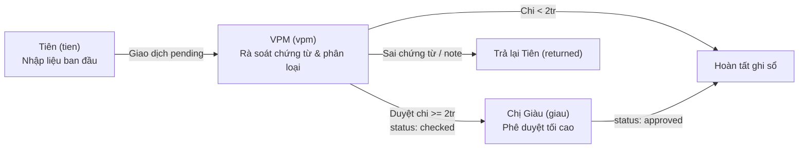

# ĐẶC TẢ NGHIỆP VỤ & LOGIC KẾ TOÁN (LOGIC.MD)
## Hệ Thống Sổ Gốc BKD TTNG · Bảo Hiểm Có Giàu

> **Dự án:** `finance-vpm`  
> **Phiên bản kiến trúc:** React 19 + TypeScript (Vite)  
> **Tài liệu tham chiếu:** [AGENTS.md](file:///d:/Desktop/admin/finance-vpm/.agents/AGENTS.md) · [SKILL.md](file:///d:/Desktop/admin/finance-vpm/.agents/SKILL.md)  
> **Cập nhật lần cuối:** 19/10/2026

---

## 📑 MỤC LỤC
1. [Tổng Quan Kiến Trúc & Quản Trị Trạng Thái (Centralized State)](#1-tổng-quan-kiến-trúc--quản-trị-trạng-thái)
2. [Ma Trận Phân Quyền & Kiểm Soát 3 Lớp (Role Matrix)](#2-ma-trận-phân-quyền--kiểm-soát-3-lớp)
3. [Nghiệp Vụ Sổ Cái & Quản Trị Dòng Tiền (Ledger & Cash Flow)](#3-nghiệp-vụ-sổ-cái--quản-trị-dòng-tiền)
4. [Nghiệp Vụ Công Nợ & Tuổi Nợ (Debt & Aging Analysis)](#4-nghiệp-vụ-công-nợ--tuổi-nợ)
5. [Nghiệp Vụ Chấm Công, Tính Lương & Thuế TNCN (Payroll & PIT)](#5-nghiệp-vụ-chấm-công-tính-lương--thuế-tncn)
6. [Nghiệp Vụ Kho Quà Tặng & Ấn Phẩm (Inventory & Deduction)](#6-nghiệp-vụ-kho-quà-tặng--ấn-phẩm)
7. [Quy Trình Khóa Sổ Tháng & Nhật Ký Kiểm Toán (Closing & Audit Trail)](#7-quy-trình-khóa-sổ-tháng--nhật-ký-kiểm-toán)
8. [Từ Điển Dữ Liệu & Danh Mục Định Khoản (Data Dictionary)](#8-từ-điển-dữ-liệu--danh-mục-định-khoản)
9. [Bộ Quy Tắc Đối Soát Dữ Liệu Cũ & Bảo Toàn ACID](#9-bộ-quy-tắc-đối-soát-dữ-liệu-cũ--bảo-toàn-acid)

---

## 1. TỔNG QUAN KIẾN TRÚC & QUẢN TRỊ TRẠNG THÁI

Toàn bộ hệ thống quản lý tài chính hoạt động trên kiến trúc **State-Driven Single-Page Application (SPA)** với một nguồn chân lý duy nhất (Single Source of Truth) được quản lý tại [`AppContext.tsx`](file:///d:/Desktop/admin/finance-vpm/src/context/AppContext.tsx).

### 1.1. Cấu Trúc Trọng Tâm Của State `S`
```typescript
interface AppState {
  tx: Transaction[];                      // Danh sách 216+ giao dịch thu/chi/tạm ứng
  contracts: Contract[];                  // Danh sách 18 hợp đồng công nợ (KH & TV)
  gifts: {
    items: GiftItem[];                    // Danh mục 6 mặt hàng quà tặng/ấn phẩm
    mv: GiftMovement[];                   // Lịch sử 13+ phiếu xuất/nhập kho
  };
  staff: Staff[];                         // 5 nhân sự văn phòng & thông tin lương
  att: Record<string, AttendanceRecord>;  // Bảng chấm công theo nhân viên & ngày ISO
  attMonth: string;                       // Tháng chấm công hiện hành (mặc định: '2026-09')
  holidays: string[];                     // Danh sách ngày nghỉ lễ (VD: '2026-09-01', '2026-09-02')
  budget: Record<string, Record<string, number>>; // Ngân sách giao theo tháng & danh mục OPEX
  locks: Record<string, string>;          // Bản đồ khóa sổ: { '2026-08': '2026-10-16' }
  close: Record<string, MonthClosingData>;// Dữ liệu checklist & chốt sổ từng tháng
  log: AuditLog[];                        // Nhật ký kiểm toán hành vi (Audit Trail)
}
```

### 1.2. Cơ Chế Lưu Trữ & Đồng Bộ Hóa 2 Chiều
- **Khóa lưu trữ:** `sogoc-bkd-v1` (lưu toàn bộ dữ liệu nghiệp vụ) và `sogoc-bkd-v1-ui` (lưu trạng thái hiển thị giao diện: vai trò người dùng, tháng đang xem, bộ lọc).
- **Tính phản ứng (Reactivity):** Mọi thao tác thêm/sửa/xóa/phê duyệt đều kích hoạt cập nhật React State, tự động tính toán lại P&L, số dư sổ quỹ, công nợ, bảng lương ngay lập tức mà không cần tải lại trang.

---

## 2. MA TRẬN PHÂN QUYỀN & KIỂM SOÁT 3 LỚP

Hệ thống thiết lập nguyên tắc **Four-Eyes Principle (Kiểm soát 4 mắt)** để ngăn ngừa gian lận và sai sót kế toán ([`constants.ts`](file:///d:/Desktop/admin/finance-vpm/src/data/constants.ts)):



### 2.1. Bảng Quyền Hạn Chi Tiết (`canDo(action)`)

| Hành động (`action`) | Tiên (`tien`) | VPM (`vpm`) | Chị Giàu (`giau`) | Điều kiện nghiệp vụ |
| :--- | :---: | :---: | :---: | :--- |
| **Ghi giao dịch (`add`)** | ✅ | ✅ | ❌ | Tháng phát sinh chưa bị khóa sổ (`!state.locks[month]`). |
| **Sửa / Gắn nhãn giao dịch (`edit`)** | ❌ | ✅ | ❌ | Chỉ VPM mới được chuẩn hóa định khoản và phân loại chi phí. |
| **Kiểm tra chứng từ (`check`)** | ❌ | ✅ | ❌ | Chuyển `pending` $\rightarrow$ `checked`. |
| **Trả lại chứng từ (`return`)** | ❌ | ✅ | ❌ | Chuyển trạng thái `returned`, yêu cầu Tiên bổ sung hồ sơ. |
| **Duyệt chi lớn (`approve`)** | ❌ | ❌ | ✅ | Bắt buộc đối với khoản chi ra $\ge 2.000.000$ đ. |
| **Duyệt chiết khấu HĐ (`approveDiscount`)** | ❌ | ❌ | ✅ | Bắt buộc khi tỷ lệ chiết khấu hợp đồng $> 30\%$. |
| **Giao ngân sách (`budget`)** | ❌ | ✅ | ✅ | Thiết lập hạn mức chi tiêu từng khoản mục trong tháng. |
| **Khóa / Mở khóa sổ tháng (`lock`)** | ❌ | ✅ | ❌ | VPM thực hiện sau khi vượt qua checklist 5 bước. |
| **Chấm công & Quà tặng (`att`, `gift`)** | ✅ | ✅ | ❌ | Thao tác vận hành thường nhật. |

---

## 3. NGHIỆP VỤ SỔ CÁI & QUẢN TRỊ DÒNG TIỀN

Tập trung tại mã nguồn: [`financeService.ts`](file:///d:/Desktop/admin/finance-vpm/src/services/financeService.ts).

### 3.1. Các Tài Khoản Tiền & Số Dư Đầu Kỳ
Hệ thống theo dõi 3 tài khoản dòng tiền độc lập ([`constants.ts:L7-L17`](file:///d:/Desktop/admin/finance-vpm/src/data/constants.ts#L7-L17)):
1. **`QUY` (Sổ quỹ tiền mặt văn phòng):**
   - **Số dư khởi tạo (01/08/2026):** **$-1.487.000$ đ** (Do văn phòng ban đầu chi vượt thu).
2. **`ACB` (Tài khoản ngân hàng Trần Thị Ngọc Giàu):**
   - Số dư khởi tạo (01/08/2026): **$0$ đ**.
3. **`BT` (Bù trừ thu nhập):**
   - Tài khoản hạch toán trung gian không luân chuyển tiền mặt (chiết khấu cấn trừ hoa hồng).

### 3.2. Công Thức Tính Số Dư Lũy Kế Thời Gian Thực
Số dư của tài khoản $acc$ tại thời điểm ngày $T$:

$$\text{Balance}(acc, T) = \text{OpenBal}[acc] + \sum_{\substack{t.date \le T \\ t.acc = acc \\ t.status \ne 'returned'}} \Big(\mathbb{I}(t.dir = \text{'in'}) \cdot t.amt - \mathbb{I}(t.dir = \text{'out'}) \cdot t.amt\Big)$$

### 3.3. Thuật Toán Bắt Âm Quỹ (`minBalance`)
- Sắp xếp toàn bộ giao dịch theo ngày tăng dần.
- Chốt số dư cuối mỗi ngày ($endOfDay$).
- Xác định giá trị số dư nhỏ nhất trong tháng:
  $$\text{minBal} = \min_{d \in Month} \big(\text{Balance}(acc, d)\big)$$
- Nếu $\text{minBal} < 0$, hệ thống tự động gắn nhãn cảnh báo đỏ và truy vết chính xác ngày xảy ra âm quỹ (Ví dụ: âm quỹ ngày `2026-09-24` và các ngày trong tháng 10).

### 3.4. Bốn Chốt Cảnh Báo Tài Chính Tự Động (`detectAllIssues`)
1. **Chờ kiểm tra / Phê duyệt:** Phát hiện giao dịch `pending` hoặc khoản chi $\ge 2$ triệu ở trạng thái `checked`.
2. **Thu không rõ nguồn gốc:** Các khoản `THU_KHAC` mang cờ cắm `"Chưa rõ..."`.
3. **Lệch sổ công nợ vs sổ quỹ:** Các khoản tiền chỉ mới ghi nhận ở file công nợ khách hàng nhưng dòng tiền thực tế chưa vào quỹ `QUY` hoặc `ACB`.
4. **Hợp đồng chưa gắn mã:** Giao dịch loại `THU_KH` hoặc `THU_TV` nhưng trường `contract` bị bỏ trống.

---

## 4. NGHIỆP VỤ CÔNG NỢ & TUỔI NỢ

Tập trung tại mã nguồn: [`debtService.ts`](file:///d:/Desktop/admin/finance-vpm/src/services/debtService.ts).

### 4.1. Quy Chuẩn Hợp Đồng
Hệ thống quản lý 18 hợp đồng với hai phân hệ chính:
- **`KH` (Khách hàng):** 11 hợp đồng (Mã `KH01` $\rightarrow$ `KH11`), tổng phải thu: `168.336.210 đ`.
- **`TV` (Tư vấn viên / Đội ngũ):** 7 hợp đồng (Mã `TV01` $\rightarrow$ `TV07`).

### 4.2. Công Thức Tính Toán Công Nợ

$$\text{Số tiền phải thu (Due)} = \text{Phí hợp đồng (Fee)} - \text{Chiết khấu (Disc)}$$

$$\text{Số tiền đã thanh toán (Paid)} = \sum_{\substack{t.contract = contract.id \\ t.type \in \{\text{'THU\_KH'}, \text{'THU\_TV'}\} \\ t.status \ne \text{'returned'}}} t.amt$$

$$\text{Công nợ còn lại (Left)} = \text{Due} - \text{Paid}$$

### 4.3. Phân Phẩm Trạng Thái Hợp Đồng & Tuổi Nợ
- **Thu dư:** $\text{Left} < 0$ (Khách hoặc TV chuyển thừa tiền).
- **Xong:** $\text{Left} = 0$ (Đã tất toán toàn bộ công nợ).
- **Quá hạn:** $\text{Left} > 0$ và $\text{Hạn nợ (due)} < \text{Hôm nay (today)}$.
  $$\text{Số ngày quá hạn (Over)} = \text{days}(\text{due}, \text{today})$$
- **Trong hạn:** $\text{Left} > 0$ và $\text{Hạn nợ (due)} \ge \text{Hôm nay (today)}$.

### 4.4. Kiểm Soát Chiết Khấu Hợp Đồng
$$\text{Tỷ lệ chiết khấu (Rate)} = \frac{\text{Disc}}{\text{Fee}}$$
- **Ngưỡng cho phép:** $\text{DISC\_LIMIT} = 30\%$.
- Nếu $\text{Rate} > 30\%$, trường `discOk` sẽ trả về `false`. Hợp đồng rơi vào diện cảnh báo và bắt buộc Chị Giàu phê duyệt (`discApproved = true`).

---

## 5. NGHIỆP VỤ CHẤM CÔNG, TÍNH LƯƠNG & THUẾ TNCN

Tập trung tại mã nguồn: [`payrollService.ts`](file:///d:/Desktop/admin/finance-vpm/src/services/payrollService.ts).

### 5.1. Xác Định Ngày Công Chuẩn Tháng (`calculateStandardDays`)
Chế độ làm việc quy chuẩn: Làm việc từ Thứ hai đến sáng Thứ bảy (nghỉ chiều Thứ bảy và nguyên ngày Chủ nhật):
$$\text{Công chuẩn (Std)} = \text{Số ngày trong tháng} - \text{Số ngày CN} - 0.5 \times \text{Số ngày T7}$$
*(Áp dụng cho Tháng 9/2026: 30 ngày - 4 CN - 0.5 $\times$ 4 T7 = **24 ngày công chuẩn**)*.

### 5.2. Bảng Trọng Số Ký Hiệu Chấm Công

| Ký hiệu | Ý nghĩa | Trọng số công chuẩn | Trọng số lương tăng ca | Quy chuẩn pháp lý |
| :---: | :--- | :---: | :---: | :--- |
| `1` | Làm việc đủ ngày thường | $1.0$ công | $0$ | Ngày làm việc bình thường |
| `0.5` | Làm việc nửa ngày | $0.5$ công | $0$ | Nửa ca làm việc |
| `'L'` | **Nghỉ Lễ có hưởng lương** | $1.0$ công | $0$ | Nghỉ Lễ 2/9 theo Điều 112 BLLĐ 2019 (hưởng 100% lương) |
| `'X'` | **Đi làm ngày Lễ** | $1.0$ công | $2.0$ công phụ trội ($300\%$) | Điều 98 BLLĐ 2019 (Làm thêm ngày lễ hưởng ít nhất 300%) |
| `'2'` | **Đi làm ngày Chủ nhật** | $1.0$ công | $1.0$ công phụ trội ($200\%$) | Điều 98 BLLĐ 2019 (Làm thêm ngày nghỉ tuần hưởng 200%) |

### 5.3. Công Thức Lương Chi Tiết
1. **Đơn giá ngày công chuẩn (Daily Rate):**
   $$\text{Rate} = \frac{\text{Lương cơ bản (Base)} + \sum \text{Phụ cấp (Điện thoại, Xăng, Ăn trưa, Công tác)}}{\text{Công chuẩn (Std)}}$$

2. **Lương gộp (Gross Salary):**
   $$\text{Lương ngày công} = \text{Rate} \times (\text{Công thường} + \text{Công nghỉ Lễ 'L'})$$
   $$\text{Lương làm thêm phụ trội} = \text{Rate} \times (\text{Công lễ 'X'} \times 3 + \text{Công CN '2'} \times 2)$$
   $$\text{Gross} = \text{Lương ngày công} + \text{Lương làm thêm phụ trội} + \text{Thưởng KPI}$$

3. **Bảo hiểm trích trừ người lao động (10.5%):**
   $$\text{Ins} = \text{Lương đóng bảo hiểm (insSalary)} \times 10.5\%$$
   *(Gồm: 8% BHXH + 1.5% BHYT + 1% BHTN)*.

4. **Các khoản được miễn thuế TNCN (Exemptions):**
   - Tiền phụ cấp theo ngày công thực tế: $\text{Exempt}_{\text{allow}} = \frac{\text{Lương ngày công} \times \sum \text{Phụ cấp}}{\text{Base} + \sum \text{Phụ cấp}}$
   - Tiền lương làm thêm giờ vượt mức bình thường: $\text{Exempt}_{\text{ot}} = \text{Rate} \times (\text{Công lễ 'X'} \times 2 + \text{Công CN '2'} \times 1)$
   $$\text{Exempt} = \text{Exempt}_{\text{allow}} + \text{Exempt}_{\text{ot}}$$

5. **Thu nhập tính thuế TNCN (Taxable Income):**
   $$\text{Taxable} = \max\Big(0,\; \text{Gross} - \text{Ins} - \text{Exempt} - \text{DEDUCT\_SELF} - \text{deps} \times \text{DEDUCT\_DEP}\Big)$$
   - **Giảm trừ bản thân (`DEDUCT_SELF`):** `15.500.000 đ`/tháng.
   - **Giảm trừ người phụ thuộc (`DEDUCT_DEP`):** `6.200.000 đ`/người/tháng.

6. **Biểu Thuế Thu Nhập Cá Nhân Lũy Tiến Từng Phần:**

| Bậc thuế | Phần thu nhập tính thuế / tháng | Thuế suất |
| :---: | :--- | :---: |
| **Bậc 1** | Đến 10 triệu đồng | $5\%$ |
| **Bậc 2** | Trên 10 triệu đến 30 triệu đồng | $10\%$ |
| **Bậc 3** | Trên 30 triệu đến 60 triệu đồng | $20\%$ |
| **Bậc 4** | Trên 60 triệu đến 100 triệu đồng | $30\%$ |
| **Bậc 5** | Trên 100 triệu đồng | $35\%$ |

7. **Lương thực nhận (Net Take-home Pay):**
   $$\text{Net} = \text{Gross} - \text{Ins} - \text{Tax} - \text{Tạm ứng (Advance)}$$

---

## 6. NGHIỆP VỤ KHO QUÀ TẶNG & ẤN PHẨM

Tập trung tại mã nguồn: [`inventoryService.ts`](file:///d:/Desktop/admin/finance-vpm/src/services/inventoryService.ts).

### 6.1. Danh Mục Mặt Hàng Tồn Kho

| Mã | Tên quà tặng / Ấn phẩm | Đơn vị | Đơn giá chuẩn hóa |
| :---: | :--- | :---: | :---: |
| `Q01` | Hộp bánh trung thu | Hộp | 271.675 đ |
| `Q02` | Quà bốc thăm hội thảo | Phần | 666.364 đ |
| `Q03` | Ấn phẩm, brochure giới thiệu | Cuốn | 14.850 đ |
| `Q04` | Tờ rơi thẻ quyền lợi | Tờ | 3.208 đ |
| `Q05` | Hashtag cầm tay sự kiện | Cái | 76.667 đ |
| `Q06` | Túi đựng quà cao cấp | Cái | 5.350 đ |

### 6.2. Cân Đối Tồn Kho & Khấu Trừ Tư Vấn 50%
1. **Cân đối tồn kho:**
   $$\text{Tồn kho cuối kỳ} = \sum \text{Số lượng nhập (Kind = 'in')} - \sum \text{Số lượng xuất (Kind = 'out')}$$
2. **Quy tắc khấu trừ tư vấn (Consultant Deduction):**
   - Khi tạo phiếu xuất quà tặng cho thành viên đội ngũ (`to === 'TV'`), hệ thống kích hoạt nghiệp vụ bù trừ:
   - **50% giá trị quà** tính vào chi phí văn phòng.
   - **50% giá trị quà** tự động khấu trừ vào thu nhập / hoa hồng của tư vấn viên thụ hưởng.

---

## 7. QUY TRÌNH KHÓA SỔ THÁNG & NHẬT KÝ KIỂM TOÁN

Tập trung tại mã nguồn: [`ClosingView.tsx`](file:///d:/Desktop/admin/finance-vpm/src/features/closing/ClosingView.tsx).

### 7.1. Bộ Tiêu Chuẩn 5 Điểm Bắt Buộc Trước Khi Khóa Sổ
VPM chỉ được phép bấm **"Khóa sổ tháng"** khi đạt đủ 5 điều kiện:
1. `pendingTx === 0`: Không còn bất kỳ giao dịch nào ở trạng thái chờ kiểm tra.
2. `pendingAppr === 0`: Toàn bộ các khoản chi $\ge 2.000.000$ đ đã có chữ ký duyệt của Chị Giàu.
3. `reconciledBank === true`: Đã khớp từng dòng tiền mặt tại quỹ và sao kê ngân hàng ACB.
4. `lockedPayroll === true`: Bảng chấm công và bảng lương nhân sự đã được ký duyệt.
5. `reconciledDebt === true`: Đã rà soát biến động công nợ trong tháng.

### 7.2. Cơ Chế Khóa Cứng & Bất Biến (Immutability)
- Khi khóa sổ tháng $M$, giá trị được ghi nhận vào `state.locks[M] = TODAY`.
- Hàm `addTransaction` sẽ **chặn đứng** mọi thao tác ghi thêm giao dịch có ngày thuộc tháng $M$.
- Nếu cần điều chỉnh, chỉ có tài khoản **VPM** mới có quyền mở khóa (`unlockMonth`), và thao tác này lập tức ghi vào Audit Trail.

---

## 8. TỪ ĐIỂN DỮ LIỆU & DANH MỤC ĐỊNH KHOẢN

### 8.1. Các Loại Giao Dịch (`Transaction.type`)

| Mã loại | Tên nghiệp vụ | Chiều dòng tiền (`dir`) | Ghi chú kế toán |
| :--- | :--- | :---: | :--- |
| `THU_KH` | Thu khách trả nợ | `in` (Vào) | Bắt buộc liên kết mã hợp đồng `KHxx` |
| `THU_TV` | Thu tư vấn trả nợ | `in` (Vào) | Bắt buộc liên kết mã hợp đồng `TVxx` |
| `HOA_HONG` | Hoa hồng BKD | `in` (Vào) | Dòng tiền về tài khoản ACB |
| `DFAM_CAP` | DFAM cấp vốn hoạt động | `in` (Vào) | Vốn tài trợ hoạt động từ DFAM |
| `THU_KHAC` | Thu khác | `in` (Vào) | Cần ghi rõ nội dung, gắn cờ nếu chưa rõ |
| `OPEX` | Chi phí vận hành | `out` (Ra) | Bắt buộc phân loại vào danh mục chi phí (`cat`) |
| `UNG_PHI` | Ứng phí nộp hộ khách hàng | `out` (Ra) | Chi hộ để giữ hiệu lực hợp đồng bảo hiểm |
| `HOAN_UNG` | Hoàn ứng tháng trước | `out` (Ra) | Thanh toán hoàn trả các khoản chi cá nhân |
| `CHUYEN_DFAM`| Chuyển tiền về DFAM | `out` (Ra) | Kết chuyển dòng tiền thặng dư về tổng |
| `TAM_UNG` | Tạm ứng lương nhân sự | `out` (Ra) | Tự động cấn trừ vào thực lĩnh cuối tháng |

### 8.2. Danh Mục Chi Phí Vận Hành (`OPEX Categories`)
- `LUONG`: Lương cơ bản, phụ cấp, tiền làm thêm giờ, thưởng KPI.
- `VP`: Thuê mặt bằng, điện thoại, internet, văn phòng phẩm, tiện ích.
- `SUKIEN`: Hội thảo khách hàng, workshop, quảng cáo marketing.
- `CSKH`: Quà tặng sinh nhật, thăm hỏi khách hàng, ấn phẩm.
- `NOIBO`: Họp giao ban, tiếp khách, liên hoan nội bộ đội ngũ.
- `KHAC`: Các chi phí linh tinh chưa phân loại.

---

## 9. BỘ QUY TẮC ĐỐI SOÁT DỮ LIỆU CŨ & BẢO TOÀN ACID

Hệ thống kế thừa và chuẩn hóa dữ liệu từ 8 file cũ, bảo đảm số liệu đối chiếu 1:1 không sai lệch:

| Chỉ số kế toán | Số liệu file cũ | Số liệu chuẩn hóa trên Sổ Gốc | Đánh giá & Xử lý |
| :--- | :---: | :---: | :--- |
| **Công nợ quá hạn KH** | `52.254.500 đ` | `52.254.500 đ` | **Khớp 100%** tuyệt đối. |
| **Tổng nợ phải thu KH** | `168.694.710 đ`| `168.336.210 đ`| Chênh lệch `358.500 đ` do file cũ cộng trùng dòng chưa trừ chiết khấu. |
| **Lương nhân sự T10** | `109.000 đ` | `0 đ` | File cũ ghi tạm ứng lẻ 109k, đã chuyển sang đúng cột Tạm ứng. |
| **Chi khác T8** | `47.801.000 đ` | `47.801.000 đ` | Đã phân bổ chi tiết về đúng danh mục OPEX. |
| **Sổ quỹ tháng 10** | `-9.184.500 đ` | `-9.184.500 đ` | Khớp số dư âm do các khoản chi đầu tháng chưa kịp hoàn ứng. |

### Nguyên Tắc Bảo Toàn Dữ Liệu
1. **Tính nguyên tử (Atomicity):** Mọi giao dịch ghi vào sổ cái phải đầy đủ các trường: ngày, tài khoản, loại, số tiền, người lập.
2. **Tính nhất quán (Consistency):** Bảng cân đối tài chính luôn thỏa mãn phương trình:
   $$\text{Tổng tài sản (Tiền mặt + ACB)} = \text{Vốn ban đầu} + \text{Lợi nhuận lũy kế} - \text{Công nợ phải thu}$$
3. **Bảo toàn Audit Trail (Durability):** Mọi thao tác sửa đổi dữ liệu quá khứ đều được lưu vết vĩnh viễn trong `state.log` kèm dấu thời gian và vai trò thực hiện.
