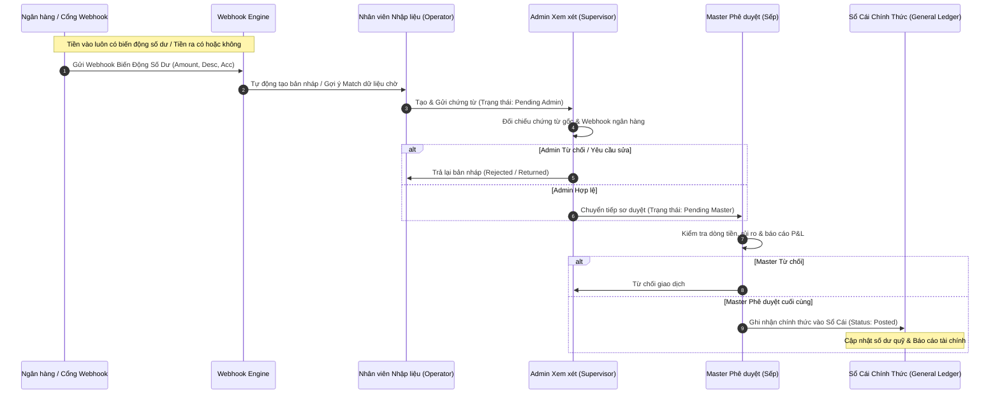

# 🏛️ ĐẶC TẢ KỸ THUẬT & QUY TRÌNH VẬN HÀNH NÂNG CẤP HỆ THỐNG `finance-vpm`

> **Dự án:** Sổ Gốc BKD TTNG & Bảo Hiểm Có Giàu (`finance-vpm`)  
> **Chủ đề:** Tích hợp Webhook biến động số dư ngân hàng & Luồng phê duyệt phân ngạch 3 cấp (Nhập liệu ➔ Admin Xem xét ➔ Master Phê duyệt ➔ Sổ cái).  
> **Ngày cập nhật:** 2026-10-19  
> **Trạng thái:** Đã được 👑 **Master** phê duyệt thiết kế.

---

## 🗺️ 1. SƠ ĐỒ KIẾN TRÚC & LUỒNG XỬ LÝ (WORKFLOW ARCHITECTURE)



---

## ⚙️ 2. CƠ CHẾ WEBHOOK & AUTO-MATCHING (BIẾN ĐỘNG SỐ DƯ)

Hệ thống kết nối trực tiếp với dịch vụ thông báo biến động số dư (ACB / SePay / VietQR Webhook):

1. **Tiền vào (Cash-in)**:
   - **100% có biến động số dư**: Mọi khoản tiền khách hàng chuyển khoản hoặc nộp vào tài khoản kinh doanh đều kích hoạt webhook.
   - **Auto-Match Engine**: Hệ thống tự động so khớp số tiền (`amount`), chiều giao dịch (`dir: 'in'`), và từ khóa nội dung chuyển khoản với các hợp đồng (`Contract`) hoặc phiếu thu chờ. Nếu khớp, trạng thái webhook chuyển thành `matched`.

2. **Tiền ra (Cash-out)**:
   - **Có hoặc không có biến động**: 
     - Trường hợp chuyển khoản tự động qua API ngân hàng: Có webhook trừ tiền.
     - Trường hợp chi tiền mặt, tạm ứng thủ công: Không có webhook ngân hàng ngay lập tức.
   - **Kiểm soát**: Tất cả các khoản chi đều phải lập chứng từ và đi qua quy trình phê duyệt 3 cấp trước khi xuất quỹ thực tế.

---

## 👥 3. PHÂN QUYỀN 3 NGẠCH TÀI KHOẢN (3-TIER ROLE-BASED ACCESS CONTROL)

| Vai trò (Role) | Tên hiển thị | Quyền hạn & Thao tác chính | Trạng thái chứng từ chịu trách nhiệm |
| :--- | :--- | :--- | :--- |
| **`operator`** | Nhân viên Nhập liệu | - Tạo mới phiếu thu, phiếu chi, hợp đồng.<br>- Gửi chứng từ lên cấp trên.<br>- Theo dõi trạng thái bản nháp. | Tạo mới (`draft`), Gửi duyệt (`pending_admin`). |
| **`admin`** | Admin Xem xét | - Kiểm tra tính hợp lệ của chứng từ.<br>- Đối chiếu biến động số dư Webhook.<br>- Sơ duyệt chuyển tiếp hoặc từ chối trả về. | Xem xét (`pending_admin` ➔ `pending_master` hoặc `rejected`). |
| **`master`** | Master Phê duyệt | - Phê duyệt quyết định cuối cùng.<br>- Khóa sổ tháng, xem báo cáo P&L tổng quan.<br>- **Ghi nhận chính thức vào Sổ cái**. | Phê duyệt cuối (`pending_master` ➔ `posted`). |

---

## 📋 4. BẢNG TRẠNG THÁI GIAO DỊCH (TRANSACTION LIFECYCLE)

```
[Draft (Nháp)] ➔ [Pending Admin (Chờ Admin)] ➔ [Pending Master (Chờ Master)] ➔ [Posted (Đã ghi Sổ Cái)]
      │                      │                            │
      └──────────────────────┴────────────────────────────┴─► [Rejected / Returned (Từ chối)]
```

- **`draft`**: Bản nháp do Nhân viên nhập liệu khởi tạo, chưa gửi duyệt.
- **`pending_admin`**: Đã gửi, đang chờ Admin kiểm tra và đối chiếu webhook.
- **`pending_master`**: Admin đã sơ duyệt, chuyển lên Master phê duyệt cuối cùng.
- **`posted`**: Đã được Master phê duyệt, chính thức nằm trong **Sổ cái (General Ledger)** và tính toán vào số dư quỹ, công nợ, P&L.
- **`rejected`**: Bị từ chối hoặc yêu cầu làm lại bởi Admin hoặc Master.

---

## 🚀 5. HƯỚNG DẪN KIỂM THỬ (TESTING & DEMO)

1. **Chuyển vai trò nhanh (Role Switcher)**: Trên thanh Header phía trên cùng của ứng dụng, sử dụng bộ chọn vai trò để chuyển đổi giữa 3 ngạch: `🟢 Nhân viên Nhập liệu`, `🟡 Admin Xem xét`, và `👑 Master Phê duyệt`.
2. **Giả lập Webhook**: Bấm nút **"Simulate Webhook"** để mô phỏng nhận thông báo biến động số dư tiền vào/ra từ ngân hàng ACB và kiểm tra tính năng tự động khớp dữ liệu (`Auto-Match`).
3. **Quy trình duyệt**:
   - Đăng nhập vai trò **Nhập liệu** ➔ Tạo giao dịch mới.
   - Chuyển sang vai trò **Admin** ➔ Kiểm tra và bấm "Duyệt sơ bộ".
   - Chuyển sang vai trò **Master** ➔ Kiểm tra và bấm "Phê duyệt cuối cùng (Vào Sổ Cái)".

---
*Tài liệu này là đặc tả chính thức (Single Source of Truth) cho việc nâng cấp hệ thống `finance-vpm` theo chỉ đạo của 👑 Master.*
