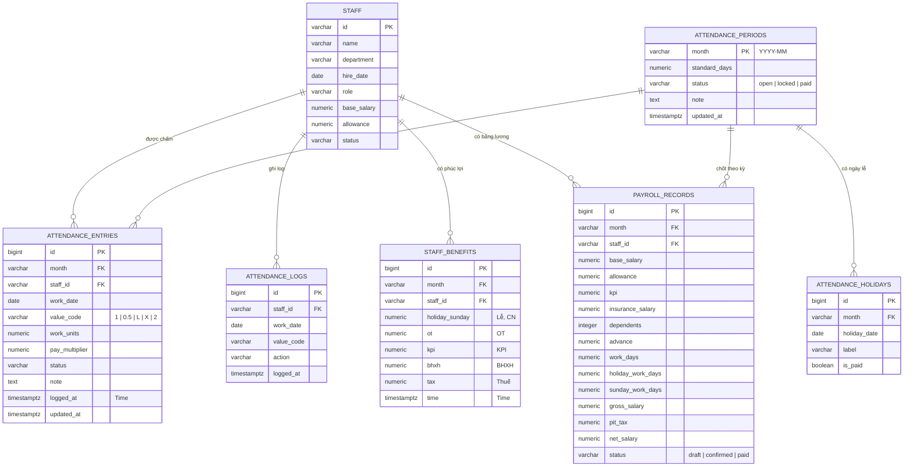

# Thiết kế cơ sở dữ liệu Chấm Công & Lương

## Sơ đồ quan hệ

## Quy tắc dữ liệu

- `attendance_periods` là bảng gốc của từng kỳ công; không dùng `app_metadata.attMonth` làm nguồn chính.
- `attendance_entries` lưu một dòng cho mỗi `nhân sự + ngày + kỳ`; khóa duy nhất là `(month, staff_id, work_date)`.
- `value_code` giữ đúng ký hiệu trên giao diện: `1`, `0.5`, `L`, `X`, `2`.
- `work_units` và `pay_multiplier` được lưu cùng dòng để đối soát rõ cách tính, không phải suy luận lại từ giao diện.
- `attendance_holidays` tách ngày lễ khỏi JSON để truy vấn, kiểm tra và khóa kỳ dễ dàng.
- `payroll_records` là snapshot bảng lương theo kỳ; khi chốt lương có thể giữ nguyên số liệu dù thông tin nhân sự thay đổi sau đó.
- `attendance_logs` là nhật ký append-only: mỗi lần nhân sự được chấm, sửa hoặc xóa ô đều tạo một log có `logged_at`.
- `staff_benefits` có một dòng khởi tạo cho mỗi `nhân sự + kỳ`; dùng để lưu `Lễ, CN`, `OT`, `KPI`, `BHXH`, `Thuế`. Khi chấm `X` ngày lễ hoặc `2` vào Chủ nhật, cột `holiday_sunday` được tính lại và cập nhật `time` trong cùng transaction.
- Các bảng chi tiết đều có khóa ngoại tới `staff` và `attendance_periods`, đồng thời có `updated_at` để kiểm toán.

## Dữ liệu đã triển khai

- Kỳ `2026-09`: `1` dòng trong `attendance_periods`.
- Ngày lễ: `4` dòng trong `attendance_holidays`.
- Chấm công: `104` dòng trong `attendance_entries`.
- Snapshot nhân sự: `5` dòng trong `payroll_records`.
- Dữ liệu cũ trong `app_metadata` đã được backfill một lần; các lần khởi động sau không ghi đè dữ liệu mới trong bảng chuẩn.
