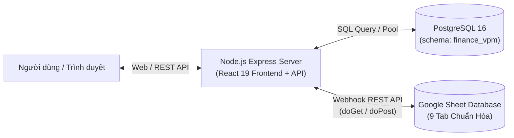

# 📘 CẨM NANG NGHIỆP VỤ & TÀI LIỆU KỸ THUẬT HỆ THỐNG (SYSTEM_GUIDE)
## Hệ Thống Sổ Gốc BKD TTNG · Bảo Hiểm Có Giàu (VPM)

> **Dự án:** `finance-vpm`  
> **Kiến trúc:** React 19 + TypeScript (Vite Frontend) + Node.js Express (Backend REST API)  
> **Lưu trữ:** Lưu trữ song song (PostgreSQL 16 & Google Sheet Headless Database)  
> **Tài liệu hợp nhất:** Kế thừa toàn bộ logic nghiệp vụ, quy chuẩn kế toán và hướng dẫn triển khai hệ thống.

---

## 📑 MỤC LỤC
1. [Kiến Trúc Hệ Thống & Vận Hành Web Độc Lập](#1-kiến-trúc-hệ-thống--vận-hành-web-độc-lập)
2. [Cấu Hình Google Sheet Làm Cơ Sở Dữ Liệu (Headless Database)](#2-cấu-hình-google-sheet-làm-cơ-sở-dữ-liệu-headless-database)
3. [Phân Quyền Vai Trò & Ma Trận Kiểm Soát 3 Cấp](#3-phân-quyền-vai-trò--ma-trận-kiểm-soát-3-cấp)
4. [Đặc Tả Nghiệp Vụ Kế Toán & Quản Trị Dòng Tiền](#4-đặc-tả-nghiệp-vụ-kế-toán--quản-trị-dòng-tiền)
5. [Nghiệp Vụ Công Nợ & Phân Tích Tuổi Nợ](#5-nghiệp-vụ-công-nợ--phân-tích-tuổi-nợ)
6. [Nghiệp Vụ Chấm Công, Tính Lương & Thuế TNCN](#6-nghiệp-vụ-chấm-công-tính-lương--thuế-tncn)
7. [Nghiệp Vụ Quản Trị Kho Quà Tặng & Ấn Phẩm](#7-nghiệp-vụ-quản-trị-kho-quà-tặng--ấn-phẩm)
8. [Quy Trình Khóa Sổ Tháng & Nhật Ký Kiểm Toán (Audit Trail)](#8-quy-trình-khóa-sổ-tháng--nhật-ký-kiểm-toán-audit-trail)
9. [Từ Điển Dữ Liệu & Danh Mục Định Khoản Chuẩn Hóa](#9-từ-điển-dữ-liệu--danh-mục-định-khoản-chuẩn-hóa)

---

## 1. KIẾN TRÚC HỆ THỐNG & VẬN HÀNH WEB ĐỘC LẬP

### 1.1. Mô Hình Triển Khai (Deployment Architecture)
Hệ thống chạy hoàn toàn độc lập trên môi trường Web Server tiêu chuẩn, loại bỏ các giới hạn sandbox của iframe trong Google Apps Script cũ:
- **Frontend SPA**: React 19 + TypeScript đóng gói bằng Vite, CSS Design System cao cấp hỗ trợ Dark Mode và biểu đồ động.
- **Backend API**: Node.js Express (cổng 3001) phục vụ REST API kết nối cơ sở dữ liệu và tự động phục vụ static file của Frontend khi chạy Production.
- **Dual-Storage**:
  - **PostgreSQL 16**: Lưu trữ bền vững dữ liệu nghiệp vụ (schema `finance_vpm`).
  - **Google Sheet Database**: Đóng vai trò là Cơ sở dữ liệu đám mây trực quan với 9 tab nghiệp vụ, đồng bộ hai chiều thời gian thực qua Webhook REST API.



### 1.2. Lệnh Khởi Chạy
- **Môi trường Dev:**
  ```bash
  npm run dev
  # Tự động chạy song song: Backend API (cổng 3001) và Vite Frontend (cổng 5173)
  ```
- **Môi trường Production (Deploy Web Server / VPS / Docker / Cloud):**
  ```bash
  npm run build
  npm start
  ```

---

## 2. CẤU HÌNH GOOGLE SHEET LÀM CƠ SỞ DỮ LIỆU (HEADLESS DATABASE)

Toàn bộ mã nguồn điều khiển Google Sheet Database được đóng gói tại tệp duy nhất:
👉 [`gas/api.gs`](file:///e:/Project/finance-vpm/gas/api.gs)

### 4 Bước Thiết Lập 3 Phút:
1. **Mở Apps Script**: Trên Google Sheet [Sổ Quỹ VPM](https://docs.google.com/spreadsheets/d/1rcoCrWhtXpwP9kGyOXzwLSxd_KRuYJPEyJOvwjStujw/edit), chọn **Tiện ích mở rộng** > **Apps Script**.
2. **Dán mã nguồn**: Copy toàn bộ mã trong file [`gas/api.gs`](file:///e:/Project/finance-vpm/gas/api.gs) dán vào `Mã.gs` và bấm Lưu (`Ctrl + S`).
3. **Khởi tạo 9 Tab Cơ sở dữ liệu**: Chọn hàm **`initAllDatabaseSheets`** > Bấm **▷ Chạy (Run)**. Google Sheet sẽ tự động sinh 9 tab chuẩn:
   - `00_SODU_KY`: Số dư đầu kỳ & cuối kỳ theo tháng
   - `01_SOGOC_2026`: Toàn bộ chứng từ giao dịch thu/chi
   - `02_HOPDONG_2026`: Hợp đồng khách hàng & công nợ
   - `03_QUATANG`: Danh mục và xuất nhập tồn quà tặng/ấn phẩm
   - `04_CHAMCONG_2026`: Dữ liệu chấm công nhân sự
   - `05_NHANSU`: Định mức lương & thông tin nhân sự
   - `06_NGANSACH_2026`: Dự toán chi phí ngân sách
   - `07_DEXUAT_KEHOACH`: Kế hoạch và tờ trình đệ trình
   - `08_DANHMUC_CHUNG`: Bảng chuẩn hóa tài khoản & danh mục
4. **Triển khai Webhook**: Bấm **Triển khai** > **Tùy chọn triển khai mới** > Loại: **Ứng dụng web** > Thực thi dưới dạng: **Tôi** > Ai có quyền truy cập: **Bất kỳ ai (Anyone)**. Sao chép URL nhận được và dán vào file `.env`:
   ```env
   GOOGLE_SHEET_API_URL=https://script.google.com/macros/s/.../exec
   ```

---

## 3. PHÂN QUYỀN VAI TRÒ & MA TRẬN KIỂM SOÁT 3 CẤP

Hệ thống áp dụng nguyên tắc **Four-Eyes Principle (Kiểm soát 4 mắt)** nhằm bảo vệ dòng tiền:

```
[ 1. TIÊN · NHẬP LIỆU ] ──► [ 2. VPM · KIỂM SOÁT ] ──► [ 3. CHỊ GIÀU · DUYỆT ] ──► [ SỔ CÁI CHÍNH THỨC ]
 (Tạo phiếu thu/chi,          (Đối soát chứng từ,       (Phê duyệt chi >= 2tr,       (Posted vào sổ quỹ &
  hợp đồng, kho quà)           sửa định khoản, soát xét) duyệt chiết khấu > 30%)     báo cáo P&L)
```

| Hành động | Tiên (`tien`) | VPM (`vpm`) | Chị Giàu (`giau`) | Điều kiện nghiệp vụ |
| :--- | :---: | :---: | :---: | :--- |
| **Ghi giao dịch mới** | ✅ | ✅ | ❌ | Tháng phát sinh chưa bị khóa sổ |
| **Sửa / Phân loại định khoản** | ❌ | ✅ | ❌ | Chỉ VPM được chuẩn hóa hạch toán |
| **Kiểm tra chứng từ** | ❌ | ✅ | ❌ | Chuyển `pending` $\rightarrow$ `checked` |
| **Trả lại chứng từ** | ❌ | ✅ | ❌ | Chuyển `returned`, yêu cầu Tiên bổ sung hồ sơ |
| **Duyệt chi lớn** | ❌ | ❌ | ✅ | Bắt buộc đối với khoản chi ra $\ge 2.000.000$ đ |
| **Duyệt chiết khấu HĐ** | ❌ | ❌ | ✅ | Bắt buộc khi chiết khấu hợp đồng $> 30\%$ |
| **Giao ngân sách** | ❌ | ✅ | ✅ | Thiết lập hạn mức chi tiêu trong tháng |
| **Khóa / Mở khóa sổ tháng** | ❌ | ✅ | ❌ | VPM thực hiện sau khi đạt checklist 5 bước |

---

## 4. ĐẶC TẢ NGHIỆP VỤ KẾ TOÁN & QUẢN TRỊ DÒNG TIỀN

### 4.1. Các Tài Khoản Dòng Tiền & Số Dư Đầu Kỳ
1. **`QUY` (Sổ quỹ tiền mặt):** Số dư khởi tạo ngày 01/08/2026: **$-1.487.000$ đ** (Do văn phòng ban đầu chi vượt thu).
2. **`ACB` (Tài khoản ngân hàng):** Số dư khởi tạo ngày 01/08/2026: **$0$ đ**.
3. **`BT` (Bù trừ thu nhập):** Tài khoản hạch toán trung gian cấn trừ hoa hồng.

### 4.2. Công Thức Số Dư & Bắt Âm Quỹ
- **Số dư tích lũy:**
  $$\text{Balance}(acc, T) = \text{OpenBal}[acc] + \sum_{\substack{t.date \le T \\ t.acc = acc \\ t.status \ne 'returned'}} (\mathbb{I}_{\text{in}} \cdot t.amt - \mathbb{I}_{\text{out}} \cdot t.amt)$$
- **Thuật toán bắt âm quỹ:** Chốt số dư cuối mỗi ngày. Nếu số dư nhỏ nhất trong tháng $\text{minBal} < 0$, hệ thống gắn cờ cảnh báo đỏ và truy vết chính xác ngày xảy ra thiếu hụt quỹ.

---

## 5. NGHIỆP VỤ CÔNG NỢ & PHÂN TÍCH TUỔI NỢ

- **Số tiền phải thu (Due):** $\text{Due} = \text{Fee (Phí hợp đồng)} - \text{Disc (Chiết khấu)}$
- **Số tiền đã thu (Paid):** Tổng các giao dịch `THU_KH` hoặc `THU_TV` đã khớp với mã hợp đồng.
- **Công nợ còn lại (Left):** $\text{Left} = \text{Due} - \text{Paid}$
- **Phân loại tuổi nợ:**
  - *Đã tất toán:* $\text{Left} = 0$.
  - *Thu thừa:* $\text{Left} < 0$.
  - *Quá hạn:* $\text{Left} > 0$ và $\text{Hạn nợ} < \text{Hôm nay}$. Tuổi nợ phân tầng: 1-30 ngày, 31-60 ngày, > 60 ngày.
  - *Kiểm soát chiết khấu:* Tỷ lệ $\text{Disc} / \text{Fee} > 30\%$ bắt buộc chuyển Chị Giàu phê duyệt.

---

## 6. NGHIỆP VỤ CHẤM CÔNG, TÍNH LƯƠNG & THUẾ TNCN

### 6.1. Công Chuẩn Tháng & Ký Hiệu Chấm Công
- **Công chuẩn:** Làm việc từ Thứ 2 đến sáng Thứ 7 (24 công/tháng đối với tháng 30 ngày có 4 tuần).
- **Ký hiệu chấm công:**
  - `1`: Đi làm đủ ngày thường (1.0 công).
  - `0.5`: Đi làm nửa ngày (0.5 công).
  - `'L'`: Nghỉ Lễ hưởng nguyên lương (Điều 112 BLLĐ 2019).
  - `'X'`: Đi làm ngày Lễ (1 công thường + 2 công phụ trội làm thêm = hưởng 300% theo Điều 98 BLLĐ).
  - `'2'`: Đi làm ngày Chủ nhật (1 công thường + 1 công phụ trội = hưởng 200%).

### 6.2. Công Thức Lương & Thuế TNCN Lũy Tiến
1. **Đơn giá ngày công:** $\text{Rate} = (\text{Lương cơ bản} + \sum \text{Phụ cấp}) / \text{Công chuẩn}$
2. **Lương gộp (Gross):** $\text{Gross} = \text{Lương ngày công} + \text{Lương làm thêm giờ} + \text{Thưởng KPI}$
3. **Bảo hiểm người lao động (10.5%):** Gồm 8% BHXH + 1.5% BHYT + 1% BHTN trích theo lương đóng bảo hiểm.
4. **Miễn trừ thuế:** Khoản phụ cấp ăn trưa/điện thoại/công tác và phần lương làm thêm giờ phụ trội được miễn thuế TNCN.
5. **Thu nhập tính thuế:** Trừ giảm trừ gia cảnh bản thân (`15.500.000 đ`/tháng) và người phụ thuộc (`6.200.000 đ`/người/tháng).
6. **Biểu thuế lũy tiến từng phần:** 5% (đến 10tr), 10% (10-30tr), 20% (30-60tr), 30% (60-100tr), 35% (> 100tr).
7. **Lương thực nhận (Net):** $\text{Net} = \text{Gross} - \text{Bảo hiểm} - \text{Thuế TNCN} - \text{Tạm ứng}$

---

## 7. NGHIỆP VỤ QUẢN TRỊ KHO QUÀ TẶNG & ẤN PHẨM

- **Danh mục:** Gồm 6 mặt hàng chuẩn hóa (`Q01` Bánh trung thu, `Q02` Quà bốc thăm hội thảo, `Q03` Brochure ấn phẩm, `Q04` Tờ rơi, `Q05` Hashtag, `Q06` Túi quà tặng).
- **Quy tắc khấu trừ tư vấn (50%):** Khi xuất quà tặng cho thành viên đội ngũ (`to === 'TV'`), hệ thống tự động:
  - Tính 50% giá trị quà vào chi phí vận hành văn phòng.
  - Tự động khấu trừ 50% giá trị quà còn lại vào thu nhập / hoa hồng của tư vấn viên thụ hưởng.

---

## 8. QUY TRÌNH KHÓA SỔ THÁNG & NHẬT KÝ KIỂM TOÁN (AUDIT TRAIL)

### 5 Tiêu Chí Bắt Buộc Trước Khi Khóa Sổ:
1. `pendingTx === 0`: Không còn giao dịch chờ kiểm tra.
2. `pendingAppr === 0`: Các khoản chi $\ge 2$ triệu đã có chữ ký phê duyệt của Chị Giàu.
3. `reconciledBank === true`: Đã đối soát khớp tiền mặt và sao kê ngân hàng.
4. `lockedPayroll === true`: Bảng chấm công và bảng lương đã ký chốt.
5. `reconciledDebt === true`: Đã rà soát biến động công nợ trong tháng.

Khi khóa sổ, hệ thống đóng băng toàn bộ giao dịch của tháng đó để chống sửa lùi ngày, đồng thời lưu vết toàn bộ thay đổi vào `state.log`.

### 8.2. Cron Job Chuyển Kỳ Tự Động (00:01 Ngày 01 Hàng Tháng)
- **Lịch trình:** Đúng `00:01` ngày 01 của mỗi tháng (`1 0 1 * *`, Timezone: `Asia/Ho_Chi_Minh`).
- **Quy tắc kế toán bất biến:**
  $$\text{Số dư đầu kỳ tháng mới} = \text{Số dư cuối kỳ tháng trước}$$
  - $\text{StartQuy}_{\text{tháng mới}} = \text{EndQuy}_{\text{tháng trước}}$
  - $\text{StartAcb}_{\text{tháng mới}} = \text{EndAcb}_{\text{tháng trước}}$
  - $\text{StartTotal}_{\text{tháng mới}} = \text{EndTotal}_{\text{tháng trước}}$
- **Quy trình thực thi:**
  1. Tự động đóng sổ kỳ tháng trước: `status = 'closed'`.
  2. Tạo dòng dữ liệu kỳ mới trong bảng `finance_vpm.monthly_balances`: `status = 'open'`.
  3. Bắn Webhook tức thời cập nhật tab `00_SODU_KY` trên Google Sheet.
  4. Cơ chế tự phục hồi (Self-Healing): Mỗi khi Server khởi động, hệ thống tự động kiểm tra đảm bảo tháng hiện tại luôn tồn tại, không bao giờ bị đứt quãng.
- **Thao tác thủ công:** Có thể bấm nút **⚡ Chạy Cron tạo tháng mới** hoặc gọi API `POST /api/cron/trigger-rollover` khi cần thử nghiệm hoặc trigger bên ngoài.

---

## 9. TỪ ĐIỂN DỮ LIỆU & DANH MỤC ĐỊNH KHOẢN CHUẨN HÓA

### 9.1. Các Loại Giao Dịch (`Transaction.type`)
- `THU_KH`: Thu khách trả nợ (bắt buộc gắn hợp đồng `KHxx`).
- `THU_TV`: Thu tư vấn trả nợ (bắt buộc gắn hợp đồng `TVxx`).
- `HOA_HONG`: Hoa hồng kinh doanh BKD về tài khoản.
- `DFAM_CAP`: Vốn cấp hoạt động từ DFAM.
- `THU_KHAC`: Thu khác (cần ghi chú rõ ràng).
- `OPEX`: Chi phí vận hành văn phòng (bắt buộc phân loại `cat`).
- `UNG_PHI`: Ứng phí nộp hộ giữ hợp đồng khách hàng.
- `HOAN_UNG`: Hoàn ứng các khoản chi cá nhân.
- `CHUYEN_DFAM`: Kết chuyển dòng tiền thặng dư về DFAM.
- `TAM_UNG`: Tạm ứng lương nhân sự (cấn trừ cuối tháng).

### 9.2. Danh Mục Chi Phí Vận Hành (`OPEX`)
- `LUONG`: Lương cơ bản, phụ cấp, tiền làm thêm giờ, thưởng KPI.
- `VP`: Thuê mặt bằng, điện nước, internet, văn phòng phẩm.
- `SUKIEN`: Hội thảo khách hàng, workshop, marketing.
- `CSKH`: Quà tặng sinh nhật, chăm sóc khách hàng, ấn phẩm.
- `NOIBO`: Họp giao ban, tiếp khách, sinh hoạt nội bộ.
- `KHAC`: Chi phí vận hành khác.
